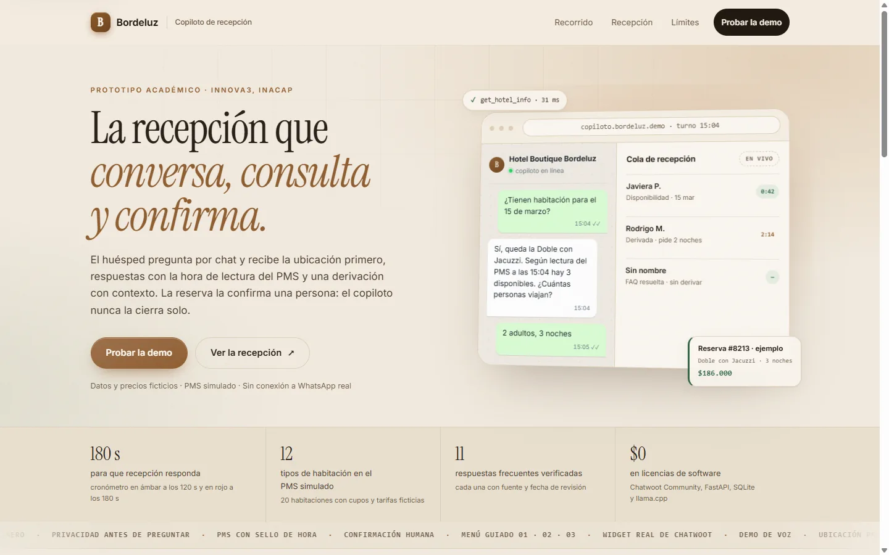
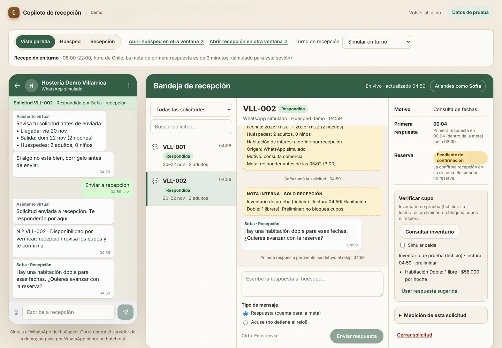
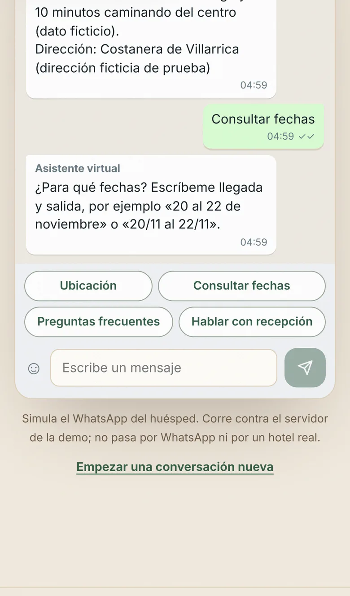
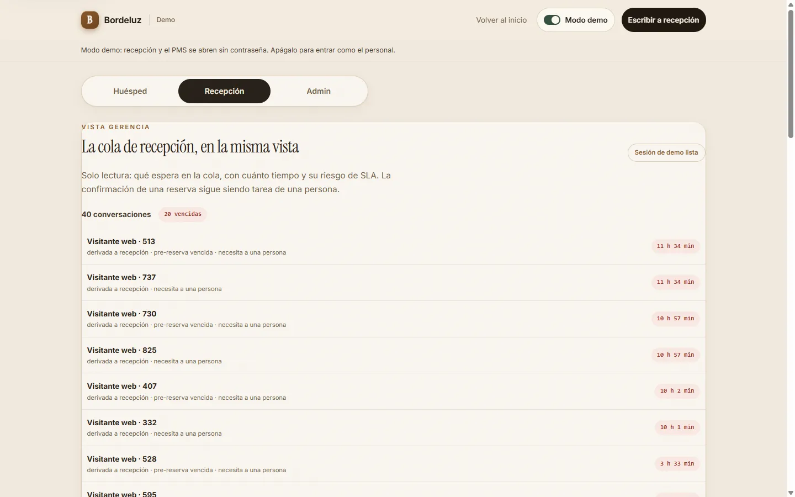
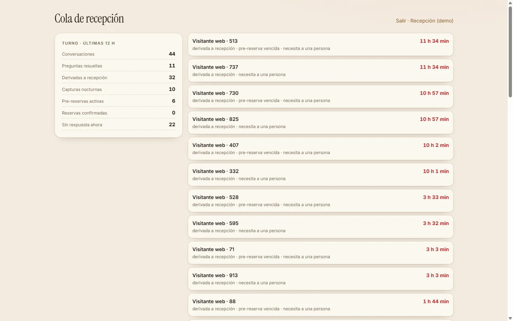
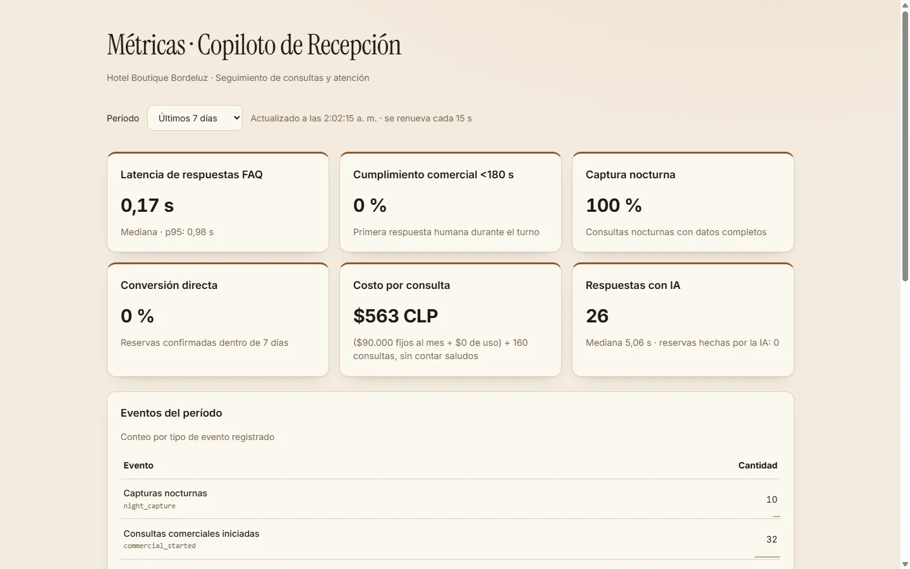
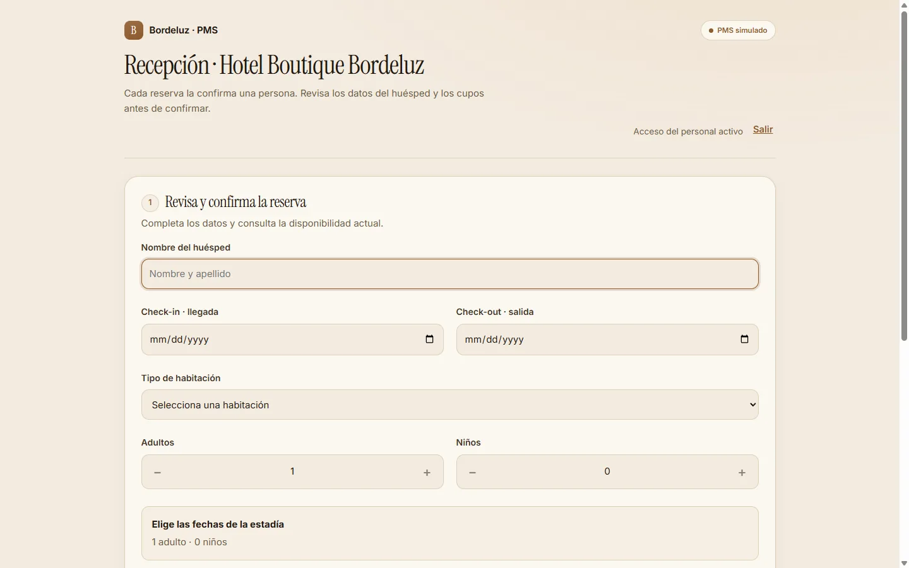
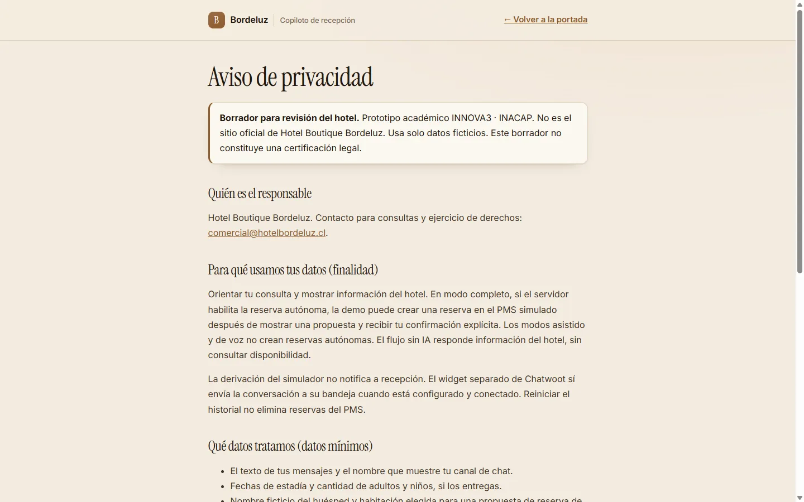

# Copiloto de Recepción · demo Hotel Bordeluz

Prototipo funcional del asistente de recepción diseñado en los informes EVA1/EVA2 de INNOVA3 (INACAP).
Orienta consultas por chat, muestra la **ubicación primero**, responde preguntas frecuentes en segundos,
lee la disponibilidad del PMS **con sello de hora** y deriva a recepción con contexto y un cronómetro de
3 minutos. Con IA entiende lenguaje libre; en el diseño de los informes **el bot nunca confirma una reserva** y
la confirma una persona en el PMS (en la demo, el modo `full` reserva en un PMS simulado).

> Versión publicada (portfolio): <https://copiloto-recepcion.vercel.app>. Corre sin servidor propio: los
> guiones viven en el navegador, el chat usa DeepSeek y la llamada ElevenLabs con las claves del proyecto
> (ver [despliegue](docs/despliegue.md)); sin claves sigue andando con el guion y la voz del navegador.

> Prototipo académico, no es el sitio oficial del hotel. Todos los datos de huéspedes son ficticios; los
> precios, los cupos y la distribución de las 20 habitaciones del PMS son simulados.

## Probar la demo (arranque oficial de la evaluación)

Requisitos: [`uv`](https://docs.astral.sh/uv/) y Python 3. Sin Docker, sin Chatwoot, sin modelo y sin
credenciales externas.

```bash
make demo-local
```

Sin `make` (Windows con Git Bash) es lo mismo: `./scripts/demo-local.sh`. El lanzador comprueba que los
puertos 8080, 8100 y 8200 estén libres, espera (90 s como máximo, `DEMO_TIMEOUT=180` para más) a que
respondan la portada, el copiloto y el PMS simulado, y recién entonces imprime **«listo»**. Si un servicio
falla, dice cuál, muestra el final de su log (`.demo-local/logs/`) y detiene solo lo que él inició.

Abre **http://localhost:8080/demo**:

- **Vista partida** (una pantalla): el chat del huésped a la izquierda y la bandeja de recepción a la
  derecha, dentro del marco de la portada.
- **Dos ventanas**: desde `/demo`, los enlaces «Abrir huésped en otra ventana» y «Abrir recepción en otra ventana».
  La página crea una **corrida** y la deja en la URL (`?corrida=`): esos enlaces, una recarga o la misma URL
  copiada siguen en la misma corrida. Escribir a mano `/demo?vista=recepcion` sin `corrida` abre otra
  presentación, que (a propósito) no ve los casos de la primera. Recepción entra como **Sofía**.
- Fuera de 08:00–22:00 (hora de Chile) el caso queda «fuera de turno»: en la barra, **Turno de recepción →
  Simular en turno** muestra la atención con el cronómetro de 3 minutos.

Para **detener**: Ctrl+C en la terminal del lanzador. Los datos se **conservan** entre arranques
(`LIMPIO=0` también los conserva); para partir de cero, explícitamente: `make demo-local LIMPIO=1`
(`./scripts/demo-local.sh --limpio`), que borra solo las bases de `.demo-local/`.

El recorrido de presentación está en [guion de demo](docs/guion-demo.md) y la verificación en
[verificación de la demo](docs/eva3/verificacion-demo.md).

### Otros arranques (no son el de la evaluación)

| Comando | Sin `make` | Qué hace | Cuándo |
|---|---|---|---|
| `make up` | `./scripts/demo.sh up` | La misma demo en Docker (portada, copiloto, PMS), sin Chatwoot | Docker disponible |
| `make up-full` | `./scripts/demo.sh up-full` | Agrega Chatwoot, Sidekiq, Postgres y Redis (bandeja real, widget, WhatsApp) | Probar el canal real |
| `make static-demo` | `./scripts/build-static-demo.sh` | `dist/` estático sin backend (la API corre en el navegador) | Portfolio (Vercel/Netlify) |
| `make demo` | `./scripts/preflight.sh` | Chequeo previo al stack Docker: servicios, modelo local de IA y precalentado | Presentar con IA |

## Qué incluye

| Pieza | Qué hace | URL local |
|---|---|---|
| Portada | Página de producto: qué hace, recorrido y pantallas reales | http://localhost:8080 |
| Demo huésped + recepción | Chat «WhatsApp simulado» y bandeja de recepción sobre el mismo hilo, datos de prueba | http://localhost:8080/demo |
| Chatwoot Community `v4.18.0-ce` | Bandeja de recepción (MIT, $0) | http://localhost:3000 |
| `copiloto` (FastAPI) | Flujo del bot, SLA, panel, métricas, privacidad | http://localhost:8100 |
| `pms_mock` (FastAPI) | PMS simulado con los 12 tipos de habitación reales | http://localhost:8200/admin |
| Panel de recepción | Cola con tiempos de espera, riesgo de SLA y detalle por conversación | http://localhost:8100/panel |

El panel abre en la **cola**: todas las conversaciones ordenadas por riesgo, con el tiempo de espera
y el paso del flujo. Arriba muestra el **resumen del turno** —recibidas, resueltas, derivadas, capturas
nocturnas, pre-reservas— y pide nombre y contraseña, para que cada **nota del turno** quede con autor.
Los límites de escala y la comparación con la competencia están en
[escalabilidad](docs/escalabilidad.md); la evidencia de mercado, en [mercado](docs/mercado.md).

El PMS se integra por **contrato**, no por código nuevo: rutas, cabecera y token se configuran por
hotel, y `PMS_ADAPTER=none` deja al copiloto operando sin PMS (orienta y deriva, nunca promete
cupos). El contrato y el checklist de incorporación están en [conector de PMS](docs/conector-pms.md).

Todo el stack es abierto y sin costo por consulta: el modelo corre local, las tipografías se sirven
desde el propio sitio y no hay CDNs. Licencias y límites en [stack abierto](docs/stack-abierto.md).

```
Huésped ─ widget web / Telegram / WhatsApp
            │
        Chatwoot CE (rails + sidekiq + postgres + redis)
            │  webhook firmado (AgentBot)
        copiloto :8100 ── lee ──▶ pms-mock :8200
            │ nota privada, labels, asignación, estado
            └▶ Chatwoot ◀── Dashboard App (panel con cronómetro)
```

## Requisitos

- Demo de la evaluación: `uv` y Python 3 (nada más).
- Docker (OrbStack o Docker Desktop), solo para `make up`/`make up-full`; Chatwoot pide al menos **4 GB de RAM**.
- `node` para los tests de la UI de la demo. No se usa npm.

## Levantar con Docker

```bash
make up        # perfil liviano: portada, copiloto y PMS simulado (sin Chatwoot ni su token)
make up-full   # stack completo: migra Chatwoot, lo siembra y conecta el copiloto (varios minutos)
make creds     # usuarios demo y contraseña locales (stack completo)
```

En Windows con Git Bash no hace falta `make`: `./scripts/demo.sh` expone los mismos comandos
(`local`, `up`, `up-full`, `seed`, `status`, `creds`, `test`, `e2e`, `smoke`, `preflight`, `down`, `reset`).

En el perfil liviano el webhook de Chatwoot queda **cerrado** (503) y `CHATWOOT_BOT_TOKEN` no se exige: ese
token solo existe después de sembrar Chatwoot con `make up-full`. Para detener: `make down` o
`./scripts/demo.sh down`. Para borrar todo: `make reset` o `./scripts/demo.sh reset` (ambos piden confirmación).

## Demo en dos ventanas: huésped y recepción (EVA 3)

`/demo` muestra **una misma consulta desde dos roles**, con la marca, los colores y el marco del hero de la
portada: el **Hotel Boutique Bordeluz**, el flujo guiado real y el PMS simulado, sin IA ni credenciales externas.
Se levanta con `make demo-local` (ver [Probar la demo](#probar-la-demo-arranque-oficial-de-la-evaluación)).

1. Huésped (vista partida o «Abrir huésped en otra ventana», «WhatsApp simulado»): pregunta **¿Dónde queda el hotel?**, toca
   **Consultar fechas**, escribe **20–22 nov · 2 adultos** y **Sin niños**: el resumen trae la lectura del PMS
   con su hora. Luego **Enviar a recepción**.
2. Recepción (la misma corrida: vista partida o «Abrir recepción en otra ventana», entra como Sofía): la solicitud llega **Pendiente de recepción** con
   ID (BDL-NNN), fechas, huéspedes, canal y espera. **Tomar solicitud** → **En atención**; **Consultar el
   PMS** y **Enviar respuesta**.
3. El huésped ve «Sofía · Recepción» en el mismo hilo; recepción ve **Respondida** y la reserva sigue
   **Pendiente de confirmación**. Recargar ambas vistas muestra el mismo caso.

El guion completo (fuera de turno, medición, respaldos) está en [guion de demo](docs/guion-demo.md) y la
verificación D01–D10 en [verificación de la demo](docs/eva3/verificacion-demo.md).

## Recorrido con Chatwoot (stack completo, opcional)

Con `make up-full` la bandeja real de Chatwoot recibe las conversaciones del widget web. No se probó en el
entorno de esta entrega (ver la verificación).

1. En la portada abre el widget **Escribir a recepción** (Chatwoot). Envía
   **quiero reservar**. El copiloto responde igual, pero esta conversación sí entra al sistema.
2. En otra ventana entra a http://localhost:3000 como `recepcion1@bordeluz-demo.test` (contraseña con
   `make creds` o `./scripts/demo.sh creds`). La conversación del widget aparece **abierta**, con etiqueta
   `comercial`, la nota privada de pre-información y, en la barra lateral derecha, la app **Copiloto** con
   el cronómetro (verde → ámbar a los 120 s → rojo a los 180 s). Deja la bandeja abierta: mientras nadie
   de recepción está en línea el widget muestra «Estamos ausentes».
3. Responde al huésped desde la bandeja: el cronómetro se detiene. Confirma en el PMS simulado
   (http://localhost:8200/admin) con el token de personal y revisa http://localhost:8100/metricas
   (conversión, cumplimiento <180 s y costo por consulta).

## Capturas

| Landing pública | Demo: huésped y recepción en el mismo hilo |
|---|---|
|  |  |

| Chat del huésped en el teléfono | Bandeja: tomar, verificar cupo y responder |
|---|---|
|  |  |

| Panel de recepción | Métricas del piloto |
|---|---|
|  |  |

| PMS simulado | Aviso de privacidad |
|---|---|
|  |  |

El recorrido completo, las decisiones y lo que falló en el camino están en el
[caso de estudio](docs/caso-de-estudio.md).

## Pruebas y operación

```bash
make help   # lista todos los comandos
make test   # pytest de copiloto, pms_mock y los puentes (PMS y WhatsApp)
make ui-test # tests de la UI de la demo (node --test)
make demo-local # arranque oficial sin Docker (portada, copiloto y PMS simulado); LIMPIO=1 borra los datos
make e2e    # 4 casos reales contra el stack levantado (FAQ, disponibilidad, fuera de turno, PMS caído)
make smoke  # construye las imágenes y comprueba que arrancan (también corre en CI)
make backup # respaldo en caliente de Chatwoot y las bases SQLite en backups/
make piloto # métricas del piloto contra las metas de la Unidad 2 (DAYS=14)
```

El guion de la sesión con recepción, las cinco tareas y los criterios de avance están en
[piloto](docs/piloto.md). El guion de la presentación (preflight, recorrido y respaldos) está en
[guion de demo](docs/guion-demo.md). En Windows, `./scripts/demo.sh <comando>` reemplaza a `make`.

## Documentación

- [Manual de recepción](docs/manual-recepcion.md)
- [Despliegue](docs/despliegue.md)
- [Costos](docs/costos.md)
- [Privacidad (Ley 21.719)](docs/privacidad.md)
- [Asistente con IA](docs/ia.md) y su [API de la demo](docs/demo-api.md)
- [IA local (modelo y GPU)](docs/ia-local.md)
- [SEO y metadatos](docs/seo.md)

## Datos del hotel y qué falta validar

`data/hotel.yaml` concentra los datos. Cada uno lleva `source` y `status` (`verificado` o `pendiente_validar`).
Quedan **pendientes de validar con el hotel**: Km 12.5 vs 2.5 de la dirección, distancia a la playa
(35 m vs 50 m), restaurante cerrado los domingos, política de mascotas, horario real del turno humano
(default 08:00-22:00) y la retención de 90 días.

## Límites declarados

- **PMS real**: Pxsol no tiene API pública documentada. El adaptador HTTP genérico (`HttpPmsAdapter`) habla el
  contrato de `docs/conector-pms.md` y `pms_bridge` conecta Beds24; la integración real necesita credenciales del
  hotel y el acuerdo con el proveedor.
- **Canales**: la demo usa el chat web. WhatsApp y Telegram no están incluidos ni se probaron; nunca conectes el
  número real del hotel a esta demo.
- **Modelo local**: el perfil `infra/docker-compose.ia.yml` sirve Qwen3-4B-Instruct-2507 en la GPU NVIDIA
  (~1,5 s por turno) y `infra/docker-compose.ia-cpu.yml` hace lo mismo en CPU; `./scripts/demo.sh ia` elige
  solo. La comparación medida está en [IA local](docs/ia-local.md).
- **IA opcional**: con `LLM_API_KEY` el asistente entiende lenguaje libre y, conversa, consulta y deriva, y
  recepción confirma (`AI_MODE=assisted`, el valor por defecto, coherente con EVA2); `AI_MODE=full` agrega la
  reserva automática en el PMS simulado, solo como demostración técnica. Sin key funciona con el flujo guiado. Ver [asistente con IA](docs/ia.md). Para correrlo con un modelo
  local sin costo, ver [IA local](docs/ia-local.md).
- Las métricas exigen la misma sesión firmada del panel o el `PANEL_TOKEN` (header `X-Panel-Token`); con el
  modo demo activo, la consola abre la sesión sola. En un servidor, mantenlas detrás del proxy con login
  (ver [despliegue](docs/despliegue.md)).
- El procesamiento de mensajes es *a lo más una vez*: no hay duplicados, pero si Chatwoot cae justo mientras
  el bot responde, ese mensaje no se reintenta (la conversación queda pendiente). Una cola durable queda para
  la fase real.
