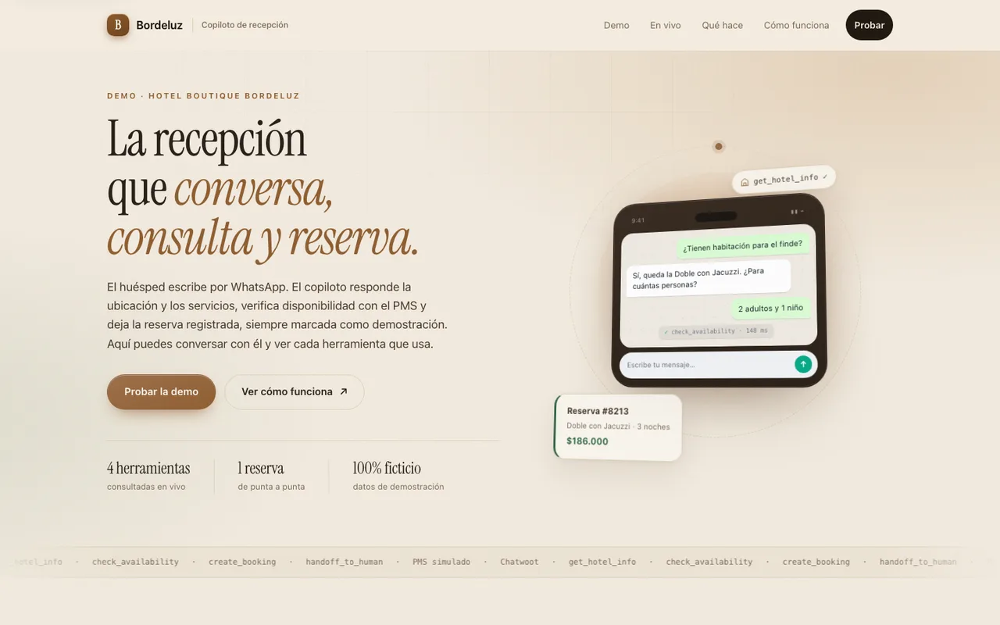
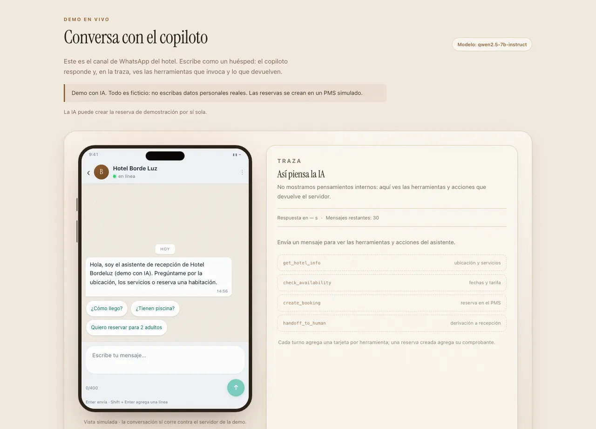
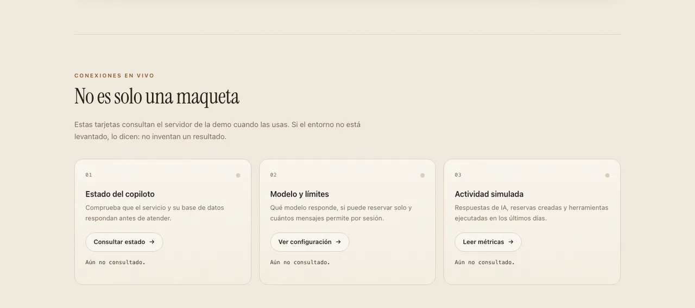
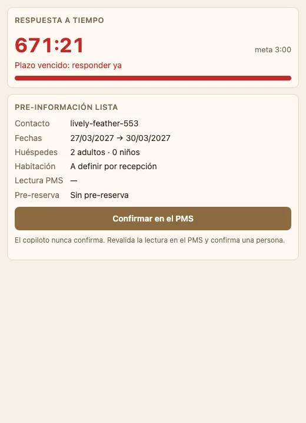
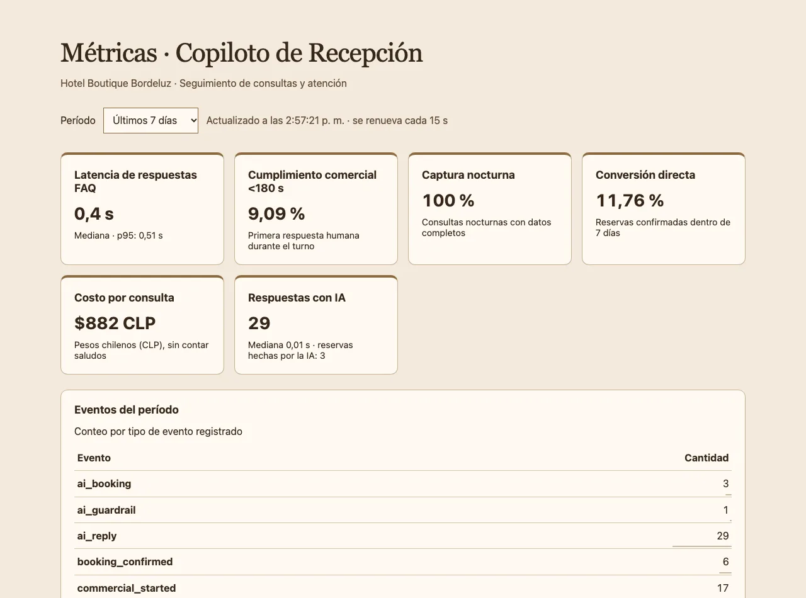
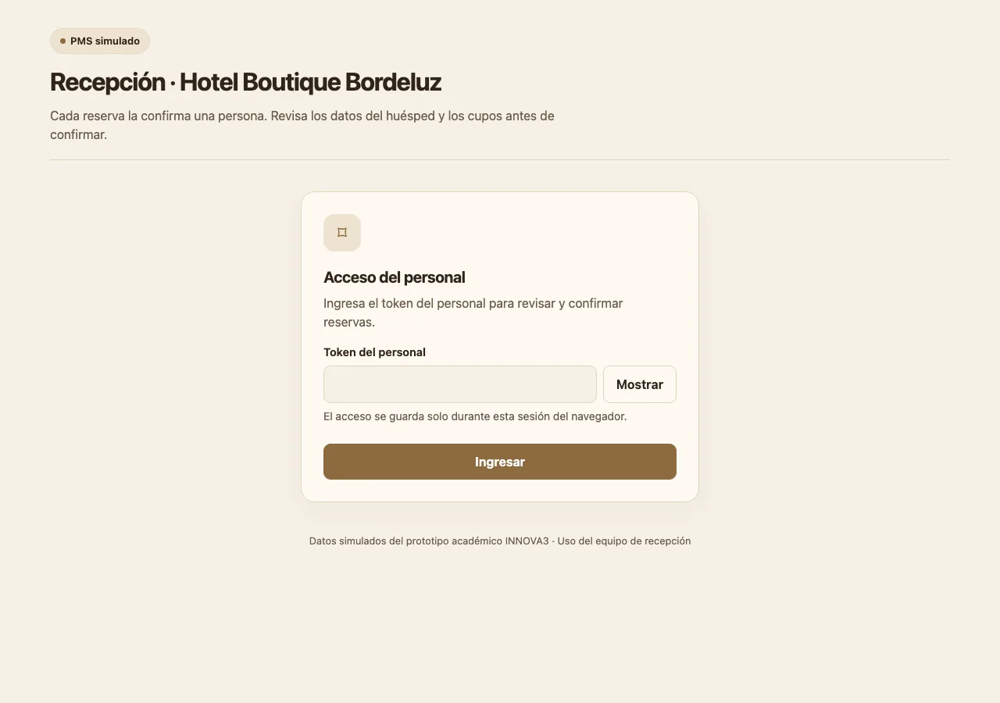

# Copiloto de Recepción · demo Hotel Bordeluz

Prototipo funcional del asistente de recepción diseñado en los informes EVA1/EVA2 de INNOVA3 (INACAP).
Orienta consultas por chat, muestra la **ubicación primero**, responde preguntas frecuentes en segundos,
lee la disponibilidad del PMS **con sello de hora** y deriva a recepción con contexto y un cronómetro de
3 minutos. Con IA entiende lenguaje libre; en el diseño de los informes **el bot nunca confirma una reserva** y
la confirma una persona en el PMS (en la demo, el modo `full` reserva en un PMS simulado).

> Prototipo académico, no es el sitio oficial del hotel. Todos los datos de huéspedes son ficticios; los
> precios, los cupos y la distribución de las 20 habitaciones del PMS son simulados.

## Qué incluye

| Pieza | Qué hace | URL local |
|---|---|---|
| Landing + widget | Página demo con el chat embebido | http://localhost:8080 |
| Chatwoot Community `v4.18.0-ce` | Bandeja de recepción (MIT, $0) | http://localhost:3000 |
| `copiloto` (FastAPI) | Flujo del bot, SLA, panel, métricas, privacidad | http://localhost:8100 |
| `pms_mock` (FastAPI) | PMS simulado con los 12 tipos de habitación reales | http://localhost:8200/admin |
| Panel de recepción | Cola con tiempos de espera, riesgo de SLA y detalle por conversación | http://localhost:8100/panel |

El panel abre en la **cola**: todas las conversaciones ordenadas por riesgo, con el tiempo de espera
y el paso del flujo. Arriba muestra el **resumen del turno** —recibidas, resueltas, derivadas, capturas
nocturnas, pre-reservas— y pide nombre y contraseña, para que cada **nota del turno** quede con autor.
Los límites de escala y la comparación con la competencia están en
[escalabilidad](docs/escalabilidad.md); la evidencia de mercado, en [mercado](docs/mercado.md).

```
Huésped ─ widget web / Telegram / WhatsApp
            │
        Chatwoot CE (rails + sidekiq + postgres + redis)
            │  webhook firmado (AgentBot)
        copiloto :8100 ── lee ──▶ pms-mock :8200
            │ nota privada, labels, asignación, estado
            └▶ Chatwoot ◀── Dashboard App (panel con cronómetro)
```

## Requisitos

- Docker (OrbStack o Docker Desktop) con al menos **4 GB de RAM**. Chatwoot es lo más pesado.
- `uv` (para correr los tests y el script e2e). No se usa npm.

## Levantar

```bash
make up        # genera secretos locales, construye, migra Chatwoot, siembra datos y espera los healthchecks
make creds     # muestra usuarios demo y contraseña locales
```

El primer arranque puede tardar varios minutos. Para detener: `make down`. Para borrar todo: `make reset`
(ambos piden confirmación).

## Recorrido de 5 minutos (profesora y hotel)

1. Abre http://localhost:8080 y el chat. Escribe **hola**: aparece el aviso de privacidad y la **ubicación**
   antes de cualquier pregunta.
2. Pregunta **¿tienen piscina?** → respuesta aprobada en segundos; la conversación sigue con el bot.
3. Elige **Disponibilidad**, escribe `15/03/2027 al 18/03/2027`, `2` adultos, `0` niños y una habitación.
   Verás «Disponible según lectura del PMS a las HH:MM … Pendiente de confirmación por recepción».
4. En otra ventana entra a http://localhost:3000 como `recepcion1@bordeluz-demo.test` (contraseña con
   `make creds`). La conversación aparece **abierta**, con etiqueta `comercial`, la nota privada de
   pre-información y, en la barra lateral derecha, la app **Copiloto** con el cronómetro (verde → ámbar a
   los 120 s → rojo a los 180 s).
   Deja la bandeja abierta: mientras nadie de recepción está en línea el widget muestra «Estamos ausentes».
5. Responde al huésped: el cronómetro se detiene. Pulsa **Confirmar en el PMS**: se abre el PMS simulado con
   los datos prellenados; ingresa el token de personal, confirma, y revisa http://localhost:8100/metricas
   (conversión, cumplimiento <180 s y costo por consulta).
6. Prueba también fuera de turno (`SHIFT_START`/`SHIFT_END` en `.env`) y con el PMS caído
   (`SIMULATE_DOWN=1`): el bot informa el horario real o dice que recepción verificará cupos, sin afirmar
   disponibilidad.

## Capturas

| Landing pública | Demo con traza de herramientas |
|---|---|
|  |  |

| Conexiones en vivo | Panel de recepción |
|---|---|
|  |  |

| Métricas del piloto | PMS simulado |
|---|---|
|  |  |

El recorrido completo, las decisiones y lo que falló en el camino están en el
[caso de estudio](docs/caso-de-estudio.md).

## Pruebas y operación

```bash
make help   # lista todos los comandos
make test   # pytest de copiloto y pms_mock
make e2e    # 4 casos reales contra el stack levantado (FAQ, disponibilidad, fuera de turno, PMS caído)
make smoke  # construye las imágenes y comprueba que arrancan (también corre en CI)
make backup # respaldo en caliente de Chatwoot y las bases SQLite en backups/
```

## Documentación

- [Manual de recepción](docs/manual-recepcion.md)
- [Despliegue](docs/despliegue.md)
- [Costos](docs/costos.md)
- [Privacidad (Ley 21.719)](docs/privacidad.md)
- [Asistente con IA](docs/ia.md) y su [API de la demo](docs/demo-api.md)

## Datos del hotel y qué falta validar

`data/hotel.yaml` concentra los datos. Cada uno lleva `source` y `status` (`verificado` o `pendiente_validar`).
Quedan **pendientes de validar con el hotel**: Km 12.5 vs 2.5 de la dirección, distancia a la playa
(35 m vs 50 m), restaurante cerrado los domingos, política de mascotas, horario real del turno humano
(default 08:00-22:00) y la retención de 90 días.

## Límites declarados

- **PMS real**: Pxsol no tiene API pública documentada. `PxsolAdapter` es un stub con el contrato; la
  integración real necesita credenciales del hotel y el acuerdo con el proveedor.
- **Canales**: la demo usa el chat web. WhatsApp y Telegram no están incluidos ni se probaron; nunca conectes el
  número real del hotel a esta demo.
- **IA opcional**: con `LLM_API_KEY` el asistente entiende lenguaje libre y, en la demo, reserva por sí solo en el
  PMS simulado (`AI_MODE=full`); sin key funciona con el flujo guiado. EVA2 describe un bot determinista que no
  confirma: eso equivale a `AI_MODE=assisted`. Ver [asistente con IA](docs/ia.md). Para correrlo con un modelo
  local sin costo, ver [IA local](docs/ia-local.md).
- Las métricas (solo contadores) no tienen autenticación propia: en un servidor, publícalas detrás de un
  proxy con login (ver [despliegue](docs/despliegue.md)).
- El procesamiento de mensajes es *a lo más una vez*: no hay duplicados, pero si Chatwoot cae justo mientras
  el bot responde, ese mensaje no se reintenta (la conversación queda pendiente). Una cola durable queda para
  la fase real.
